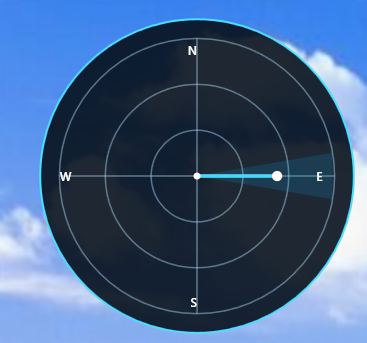

This program draws a radar as an overlay on your screen, which displays the direction from which a sound is coming from. 
It is supposed to help people with hearing disabilities when playing games where the sound has a crucial role on gameplay, for example
listening to the sound of lava/water or mobs while digging a tunnel in minecraft in order to find a cave.

This is still a work in progress, feel free to refine the code for your own personal usage.

Here is an example image of this application running while a sound is coming exclusively from the right side

